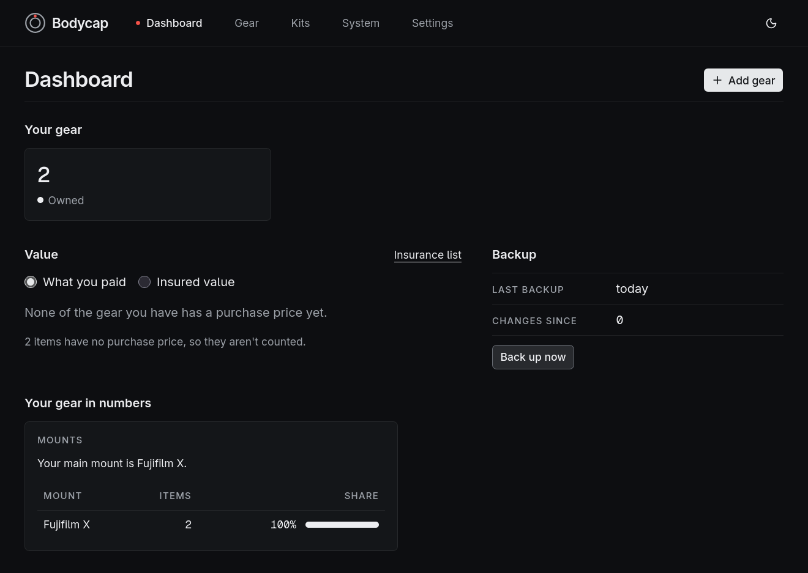
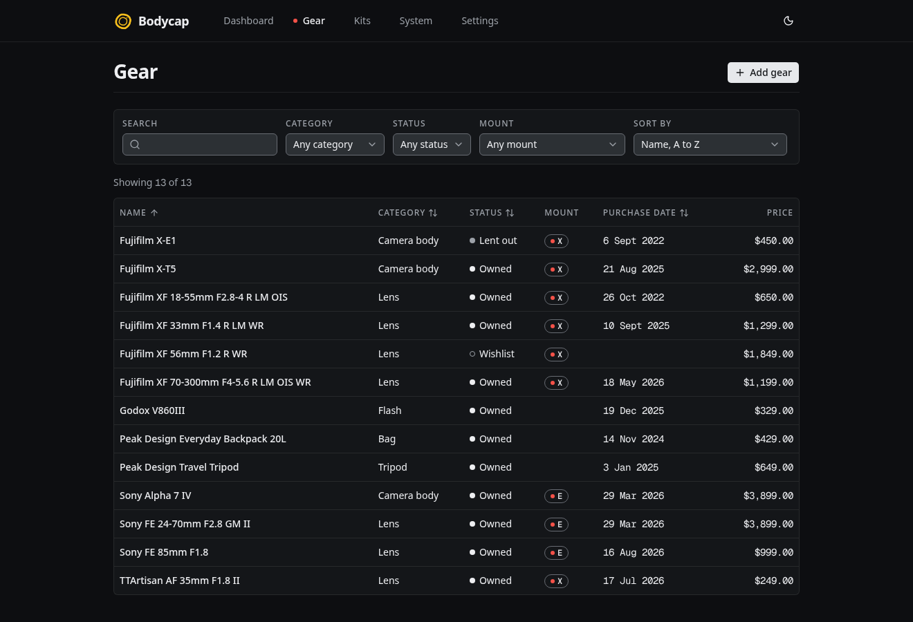

#  Bodycap

Store, organise, and keep track of your camera gear. Bodycap is a website that works like an app:
it keeps everything in your own browser, works offline, and never needs an account.

**Open it at <https://xe1af35.github.io/bodycap/>**



## What it does



- **Your gear in one place**: bodies, lenses, flashes, tripods, bags, filters, memory cards,
  batteries, drones, mount adapters, and anything else, with serial numbers, where and when you
  bought them, what you paid, condition, location, warranty, insured value, weight, and notes.
  Lenses can also record their focal length, aperture, and filter thread, and filters their size.
- **Model suggestions**: start typing a camera body or lens in the Model field, such as "a7 iv" or
  "24-70 2.8", and pick from the [gear catalogue](#the-gear-catalogue) to fill in the brand,
  mount, sensor format, focal lengths, aperture, filter thread, and weight. Everything it fills in
  stays editable, and a model it doesn't know can be typed as it is.
- **Statuses that follow real life**: owned, wishlist, lent out, in repair, sold, or lost. Buttons
  on each item's page lend it, take it back, sell it, or mark it lost, asking only for what that
  change needs, and the status list only offers changes that make sense.
- **Kits**: group gear into kits, such as a wedding kit or a travel kit, and use one as a packing
  checklist, ticking things off as they go in the bag. Share a kit as a link, and whoever opens it
  sees a read-only copy and can add its gear to their own wishlist.
- **Loans**: who has an item, how to reach them, and when it's due back. What's out shows on the
  dashboard, and an overdue loan needs attention. Each item keeps a history of its loans.
- **Photos** of each item, up to 12, taken with a phone's camera or chosen from your files.
  Bodycap shrinks each one in your browser and leaves behind the details a camera hides in the
  file, including where it was taken. The cover photo shows beside the item in your gear list.
- **A maintenance log** for each item: sensor cleans, firmware updates, and repairs, with what they
  cost and who did them.
- **What works with what**: a lens's page lists your cameras, and a body's page lists your lenses,
  saying whether each pair fits as it is, crops to APS-C, works through an adapter you own, needs
  an adapter, or doesn't fit.
- **A system map** of how it all fits together: each camera with the lenses it takes, a strip of
  the focal lengths it covers with any big gaps, what each adapter unlocks, and lenses no camera
  you have can take.
- **Search and filters** by category, status, and mount, kept in the address so you can bookmark a
  filtered list.
- **A dashboard** with counts, what your gear is worth in each currency (without converting between
  them), what's on loan, and what needs attention: overdue loans, warranties running out, the same
  serial entered twice, and a reminder when it's time for a backup. Below that, your gear in
  numbers: bodies and lenses by mount, how long ago gear was bought, the warranties still running,
  and how much of your gear is in kits.
- **A spreadsheet and an insurance list**: download your gear as a CSV file for Excel, Numbers, or
  Google Sheets, or print a list of everything you have, with serial numbers, what you paid, and
  what it's insured for, totalled in each currency. Printing it, or saving it as a PDF, always
  comes out dark on white, whichever theme you use.
- **Money in any currency**, NZD by default, with each amount keeping its own currency. Settings can
  choose the currency new amounts start in.

## Your data stays with you

Everything is stored in your browser on your device, and nothing is sent anywhere. There are no
accounts, no analytics, and no tracking.

That makes **backups important**. In Settings, Back up now saves one file with all your gear,
kits, loans, and maintenance: a `.json` file, or a `.zip` once you have photos, holding them too.
Settings can also make a much smaller `.json` without the photos. Keep your backup somewhere other
than your device, such as cloud storage or a USB drive. The dashboard reminds you when it's time for another, two weeks after the last one by
default, and Settings can make that a week or a month.

Restore takes either kind of file. It shows what a backup holds before anything changes, and
nothing changes until you confirm. It can replace everything with what's in the backup, or add the
backup to what's there, such as to bring together gear from two devices. Adding never removes
anything, and where the same record is in both, the copy changed most recently is kept. If a backup
without photos would replace the photos you have, it says so first.

**Photos never leave your device** either. Each one is redrawn in your browser before it's saved,
which leaves behind everything else in the original file, such as where it was taken and the
camera's serial number. The CSV file and the insurance list are for reading and printing, not
backups: they leave out kits, loans, maintenance, and photos, and can't be restored.

**Shared kit links** say what each item is (its brand, model, mount, and focal lengths) and
nothing about whose it is: no serial numbers, and nothing about where or when it was bought, where
it's kept, or its warranty or insurance. Prices and notes go in only if you tick them. The kit
travels in the part of the link after the `#`, which browsers never send to a server, but links
can end up in chat apps and their previews, so share them as you would the kit itself. Opening a
link is checked as carefully as a backup file, and adds nothing until you choose to.

Browsers can delete a site's data:

- clearing browsing data, or this site's data, deletes it
- a device short of space can remove a whole site's data, unless the browser has promised to keep
  it (Settings shows whether it has, and can ask)
- Safari deletes a site's data after 7 days without a visit, unless the site has been added to the
  Home Screen

## Installing it as an app

Bodycap works offline once it has loaded, and can be installed like an app:

- **Chrome or Edge**: use **Install app** in Bodycap's header, or the install button in the
  address bar.
- **iPhone or iPad**: open Bodycap in Safari, tap Share, then **Add to Home Screen**. This also
  stops Safari's 7-day deletion.

When a new version is ready, Bodycap says so and waits for you to choose Reload, so nothing you're
typing is lost. If the new version changes how your gear is stored, it suggests a backup first,
just in case.

Bodycap is made for current versions of Chrome, Edge, Firefox, and Safari. Some private windows block
the storage it needs, and it says so if that happens.

## The gear catalogue

The model suggestions come from a catalogue that ships with Bodycap, so they work offline and what
you type never leaves your browser. It holds 469 models: 144 mirrorless camera bodies from about
2017 on, and 325 lenses, from Canon, Fujifilm, Hasselblad, Leica, Nikon, Olympus, OM System,
Panasonic, Sigma, and Sony. DSLRs, third-party lenses, and cine lenses aren't in it yet.

It was put together by hand from the names, mounts, sensor formats, and lens specifications the
makers publish, and copies no other database, so it's under the same MIT licence as the rest of
Bodycap. Brand and model names belong to their owners, and Bodycap isn't connected with any of
them. The data is in `src/core/catalogue/data/`, one file per maker, and a test checks every entry
against the gear form's own rules, so a suggestion can never fill in something Bodycap wouldn't
save.

## Coming later

- A shoots log and spending charts
- Optional AI features, with everything else always working without them

## Development

Bodycap is a static site built with React 19, Vite 8, and TypeScript in strict mode. Data lives in
IndexedDB through Dexie, behind small repositories so another store could replace it. The UI uses
TanStack Router (with hash URLs, since GitHub Pages can't serve app routes), Tailwind CSS 4, and
shadcn components on Base UI. Zod checks backup files, fflate writes and reads `.zip` backups, and
vite-plugin-pwa with Workbox provides offline support.

### Getting started

You need Node 24 (see `.nvmrc`). pnpm comes through Corepack, which installs the exact version in
`package.json`:

```sh
corepack enable          # or put "corepack" in front of each pnpm command below
pnpm install
pnpm dev                 # http://localhost:5173/bodycap/
```

### Commands

| Command              | What it does                                                |
| -------------------- | ----------------------------------------------------------- |
| `pnpm dev`           | Runs the development server                                 |
| `pnpm build`         | Builds the site into `dist/`, and checks the result         |
| `pnpm preview`       | Serves `dist/` as it will be published                      |
| `pnpm lint`          | ESLint with no warnings allowed, then the Prettier check    |
| `pnpm format`        | Formats everything with Prettier                            |
| `pnpm typecheck`     | Type-checks every part of the project                       |
| `pnpm test`          | Runs the unit, storage, and UI tests with Vitest            |
| `pnpm test:coverage` | The same, failing if coverage of `src/core` drops below 95% |
| `pnpm e2e`           | Builds and serves the app, then runs the Playwright tests   |

Before the first `pnpm e2e`, install the test browsers with
`pnpm exec playwright install chromium webkit`.

### How the code is organised

```text
src/core/   Domain logic with no React, storage, or browser APIs: validation, lifecycle rules,
            kits, loans, maintenance, photo rules, mount compatibility, the system map, value
            totals, stats, alerts, search, the gear catalogue and its search, shared kit links, the
            CSV file, the insurance list, and the backup format, its .zip layout, its upgrades, and
            merging
src/data/   The only code that uses Dexie: the database and its upgrades, repositories, backup,
            restore, and merge, and storage helpers. Photos are stored as bytes, since Safari
            won't store a Blob in a private window
src/ui/     React components and pages, which reach storage only through the repositories
build/      Build helpers: the Content Security Policy, version.json, and the checks on the
            built site
tests/      Vitest tests for core, data, and UI, mirroring src/
e2e/        Playwright tests against the built site
```

ESLint keeps those boundaries: `src/core` can't import React, Dexie, or browser globals, and
`src/ui` can't import Dexie.

### Tests

- **Unit tests** cover all of `src/core`, with 95% coverage required.
- **Storage tests** run the repositories, backup, restore, and merge on fake-indexeddb, and
  upgrade a database seeded at an earlier version.
- **UI tests** render the whole app in jsdom with Testing Library.
- **End-to-end tests** run in Playwright against the built site, with its real base path, security
  policy, and service worker: adding gear, picking a lens from the model suggestions, and packing
  a kit with only a keyboard, lending and
  returning, logging maintenance, search, a backup restored into an empty browser and merged into
  another, a photo with a GPS location stored without it, a `.zip` backup with photos restored
  into an empty browser byte for byte, the CSV file, the insurance list in print, a kit shared into
  another browser's wishlist, offline use, the install manifest, focus outlines, layouts that must
  fit on a phone, and axe accessibility checks against WCAG 2.2 AA on every screen and the main
  dialogs in both themes. Every test fails on a console error or a
  security policy violation. CI runs them in Chromium; locally, WebKit also runs the storage and
  offline tests.

### Security

- A Content Security Policy in a meta tag (production builds only) allows scripts, styles, and
  workers from the site itself and nothing else.
- Trusted Types are required, so text can never be turned into script by accident. The service
  worker is registered with the one policy the app is allowed.
- User text is always shown as text, never as HTML.
- Backup files are treated as untrusted: they're size-capped, every field is checked, and every
  link between records (such as a loan's item) must point to something in the file, before a
  restore or merge.
- Shared kit links are treated the same way: size-capped, checked field by field, and held to the
  same rules as the gear form, so a changed link can't bring in anything the app wouldn't save.
- A `.zip` backup is checked before anything in it is unpacked: it may hold only the names Bodycap
  writes, each no bigger than Bodycap would make it, so a hostile file can't unpack to more than
  it holds. Nothing in the file chooses where anything goes, and every photo must be exactly the
  size its data says.
- Photos are redrawn on a canvas and encoded again before they're stored, so nothing hidden in the
  original file, such as its location, is kept.
- CSV cells that a spreadsheet would run as a formula start with an apostrophe, as OWASP advises.
- Charts are SVG drawn with attributes, not inline styles, so the security policy needs no
  exceptions for them.

### Publishing

The **Tests** workflow runs every check on each push and pull request. The **Deploy** workflow is
started by hand: it runs the tests, builds, and publishes to GitHub Pages. Pages needs the
repository to be public on a free plan, with Settings, Pages, Source set to GitHub Actions.

- The site is built for `/bodycap/`. Set `BASE_PATH` to build for another path, such as `/` for a
  repository named `<name>.github.io`.
- If a broken service worker were ever published, deploying a build made with
  `PWA_SELF_DESTROY=true` replaces it with one that removes itself.
- The app icons are made from `public/app-icon.png`, a hand-drawn icon, and committed. After
  changing the drawing, run `pnpm dlx @vite-pwa/assets-generator@1.0.4`.

### Dependencies

pnpm only installs versions that have been public for at least a day, refuses packages whose
publishing trust has dropped, and runs no install scripts. Dependabot suggests updates weekly, a
week after each release. Workflow actions are pinned to full commit SHAs.

As of October 2026, the site loads 187 kB of gzipped JavaScript at first, about 307 kB across all
its pages, and 10 kB of CSS. The code for making and reading `.zip` backups, and the gear
catalogue, load only when they're needed. The build fails if the first load passes 200 kB, or any
script loaded later passes 40 kB.

## Licence

[MIT](LICENSE). Copyright 2026 Ha Ly.
